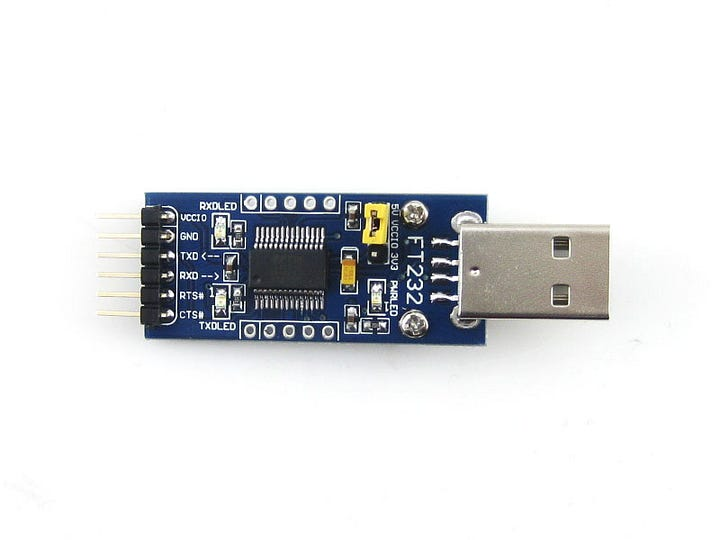

Sometimes we need the lots of components, sensors, modules using the `UART` interfaces to communicate with the Raspberry Pi.

Post in Medium: [https://medium.com/@jason19970210/raspberry-pi-4-with-multiple-uart-interface-4eac75f74d7c](https://medium.com/@jason19970210/raspberry-pi-4-with-multiple-uart-interface-4eac75f74d7c)

## Environment

1.  Hardware : Raspberry Pi 4 Model B (BCM2177\*) [ref](https://www.raspberrypi.com/documentation/computers/processors.html#bcm2711)
2.  Operation System : Respbian Linux 11
3.  CPU Arch: armv7l

There are 2 types of UART interface existed on Raspberry Pi, `mini UART` & `PL011 UART`.  
By default, `/dev/ttyS0` maps to `mini UART`; on the other hand, `/dev/ttyAMA0` maps to `PL011 UART`.

## Software Setup

```
$ sudo su
$ vim /boot/config.txt
```

add following lines at the end of the file:

```
# enable serial interface
enable_uart=1
dtoverlay=uart0
dtoverlay=uart1
dtoverlay=uart2
dtoverlay=uart3
dtoverlay=uart4
dtoverlay=uart5
```

Save, exit & Reboot !!

Check system open the serial by command $ ls -al /dev/ttyAMA\*

```
$ ls -al /dev/ttyAMA*
crw-rw---- 1 root dialout 204, 64 Dec 16 16:01 /dev/ttyAMA0
crw-rw---- 1 root dialout 204, 65 Dec 16 16:01 /dev/ttyAMA1
crw-rw---- 1 root dialout 204, 66 Dec 16 16:01 /dev/ttyAMA2
crw-rw---- 1 root dialout 204, 67 Dec 16 16:01 /dev/ttyAMA3
crw-rw---- 1 root dialout 204, 68 Dec 16 16:01 /dev/ttyAMA4
```

Let’s take a look into the Raspberry Pi 4 Model B GPIO Pinout:  
*Figure 1: image not reproduced here (source: [raspberrypi.com](https://www.raspberrypi.com/documentation/computers/images/GPIO-Pinout-Diagram-2.png)).*  
GPIO Pinout : [https://www.raspberrypi.com/documentation/computers/os.html#gpio-and-the-40-pin-header](https://www.raspberrypi.com/documentation/computers/os.html#gpio-and-the-40-pin-header)

## Hardware Setup

Raspberry Pi Pin pair with UART:

```
           TXD       RXD         Communication Port
uart0 :  GPIO 14    GPIO 15         /dev/ttyAMA0 
uart1 :  GPIO 0     GPIO 1          /dev/ttyAMA1
uart2 :  GPIO 4     GPIO 5          /dev/ttyAMA2
uart3 :  GPIO 8     GPIO 9          /dev/ttyAMA3
uart4 :  GPIO 12    GPIO 13         /dev/ttyAMA4
```

PC setup with USB-to-UART Adapter :  
  
FT232 : [https://www.waveshare.com/ft232-usb-uart-board-type-a.htm](https://www.waveshare.com/ft232-usb-uart-board-type-a.htm)

Please make sure `GND` is connected correctly !  
USB-to-UART `TXD` connect to Raspberry Pi uart `RXD` GPIO Pin  
USB-to-UART `RXD` connect to Raspberry Pi uart `TXD` GPIO Pin

Take uart3 for example:

```
USB-to-UART TXD <--> GPIO 8
USB-to-UART RXD <--> GPIO 9
USB-to-UART GND <--> GND
```

## Implementation

Once finish setup, open a serial console on PC (ex. Putty) with correct COM Port (ex. COM3) & Baud Rate set to 115200

Then open a terminal in Raspberry Pi, send message from CLI to PC :  
`$ echo 'hello' > /dev/ttyAMA3`

This command should send the string hello to PC via /dev/ttyAMA3 , then the string will be parsed by PC, finally display on serial console.  
Hope this article can help those makers connect more devices via multiple UART interfaces !!

Cover photo by [Dawid Zawiła](https://unsplash.com/@davealmine) on [Unsplash](https://unsplash.com/)
